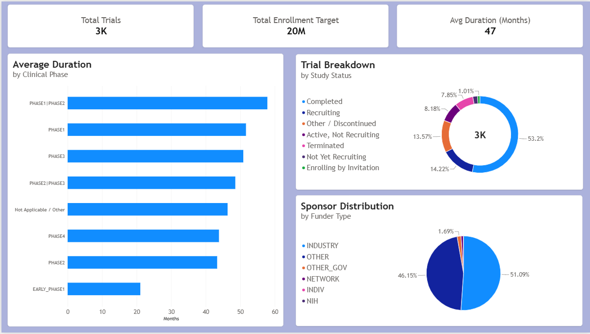
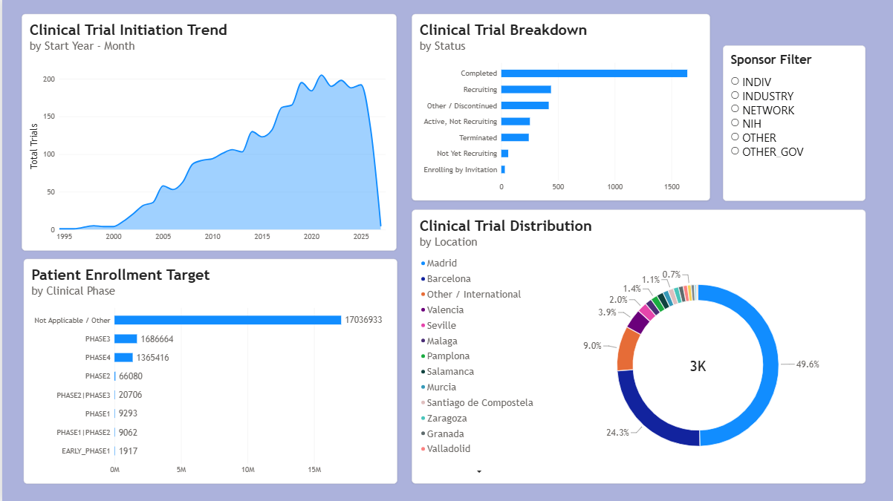

# Spain-Cardiovascular-Clinical-Trial-Operations-Analytics
An end-to-end clinical trial analytics solution analyzing **3,081 cardiovascular clinical trials in Spain** sourced from ClinicalTrials.gov. This project combines upstream SQL data engineering in SQLite with an interactive two-page Power BI dashboard to evaluate trial timelines, patient enrollment scale, funding distribution, and geographic research concentration.

---

## Dashboard Overview & Key Visualizations

### Page 1: Executive Summary


* **Key Performance Indicators (KPIs):** `Total Trials` (3K), `Total Enrollment Target` (20M), and `Avg Duration` (47 Months).
* **Average Duration by Phase:** Bar chart analyzing study timelines across development phases.
* **Trial Status Breakdown:** Donut chart evaluating study completion and active recruiting statuses.
* **Sponsor Distribution:** Proportional breakdown of funding bodies (Industry vs. Non-Profit/Gov).

---

### Page 2: Time & Geographic Distribution


* **Clinical Trial Initiation Trend:** Area chart capturing study initiation momentum over time with date hierarchy drill-down.
* **Patient Enrollment Target:** Scale distribution across clinical phases.
* **Status Pipeline Breakdown:** Operational view of current active vs. completed studies.
* **Clinical Trial Distribution:** Geographic concentration visual highlighting top Spanish medical hubs.
* **Sponsor Filter:** Interactive slicer for dynamic filtering by funder type (Industry, NIH, Network, etc.).

---

## Project Architecture & Data Pipeline

```text
[ ClinicalTrials.gov (3,081 Rows) ]
               │
               ▼
   [ SQLite Data Ingestion ]
               │
               ├──> Step 1: Data Cleaning & Duration Calculation (Julianday)
               ├──> Step 2: Operational SQL Queries & Aggregations
               └──> Step 3: Location Engineering (Regex & Pattern Matching)
               │
               ▼
     [ Power BI Data Model ]
               │
               ├──> Star Schema: Fact Table linked 1-to-1 with Dimension Table (`location`)
               └──> Core DAX Measures (`_Key Metrics`)
               │
               ▼
[ Interactive 2-Page Power BI Executive Dashboard ]
```

---

## Key Business Insights

1. **Volume & Scale:** Evaluated 3,081 total trials representing a combined target enrollment of ~20 Million patients across Spain.
2. **Geographic Centralization:** Research activity is heavily centralized in major urban medical hubs, with Madrid (~49.6%) and Barcelona (~24.3%) representing nearly three-quarters of all cardiovascular trial sites in Spain.
3. **Sponsorship Profile:** The pharmaceutical industry powers ~51.1% of cardiovascular research funding, followed by non-profit and academic institutions ("Other" at ~46.2%).
4. **Operational Duration:** Phase 1/Phase 2 combined trials exhibit the longest average timeline (~58 months), whereas Phase 1 standalone trials average ~52 months and Phase 3 trials average ~51 months.

---

## Data Modeling Architecture

The Power BI data model utilizes a star-schema design with a dedicated DAX measure table (`_Key Metrics`) and a normalized geographic dimension table:
* **Fact Table (`cleaned_clinical_trials`):** Contains trial status, standardized phase categories, enrollment numbers, dates, and calculated durations.
* **Dimension Table (`location`):** Derived upstream in SQL to parse raw site strings into clean Spanish city categories (Madrid, Barcelona, Valencia, Seville, etc.).
* **Relationship:** 1-to-1 relationship connected via `nct_id`.

---

## SQL Engineering Scripts

All database transformations and dimensional modeling steps are executed in SQLite using `DB Browser for SQLite`. 

The complete, reproducible SQL script is available in the repository root file:
📄 **[`Cardio_Trials_Spain_script.txt`](Cardio_Trials_Spain_script.txt)**

### Key Transformation Steps Handled in the Script:
1. **Data Ingestion & Staging:** Filters raw ClinicalTrials.gov records and standardizes null/missing values.
2. **Feature Engineering:** Calculates study durations in months using SQLite's `julianday()` function and groups rare operational statuses.
3. **Geographic Dimension Modeling:** Parses raw site strings using pattern matching (`LIKE` statements) to isolate major Spanish medical hubs (`Madrid`, `Barcelona`, `Valencia`, `Seville`, etc.) into a dedicated `location` dimension table linked by `nct_id`.

---

## How to Reproduce This Project

1. **Clone or Download the Repository:**
   Download or clone the project repository to your local computer.

2. **Database & SQL Pipeline:**
   * Open `DB Browser for SQLite`.
   * Run the SQL pipeline script provided in `Cardio_Trials_Spain_script.txt` against your database, or inspect the cleaned CSV datasets inside the `Data/` folder (`cleaned_clinical_trials.csv` and `location.csv`).

3. **Explore the Power BI Dashboard:**
   * Open the `Cardio_Trials_Spain.pbix` file using **Power BI Desktop**.
   * Note: If Power BI prompts for a data source reconnect, point the connection to your local copy of the SQLite database or the CSV files inside the `Data/` folder.

---

## 📁 Repository Structure

```text
├── Data/
│   ├── raw_trials.csv                 # Raw Registry Dataset
│   ├── cleaned_clinical_trials.csv    # Processed Fact Table
│   └── location.csv                   # Engineered Location Dimension
├── Cardio_Trials_SS/
│   ├── Page1_Executive_Summary.png    # Executive Summary Screenshot
│   └── Page2_Trends.png               # Time & Geography Screenshot
├── Cardio_Trials_Spain_script.txt     # Complete SQL Engineering Script
├── Cardio_Trials_Spain.pbix           # Interactive Power BI Report
└── README.md                          # Project Documentation

```
